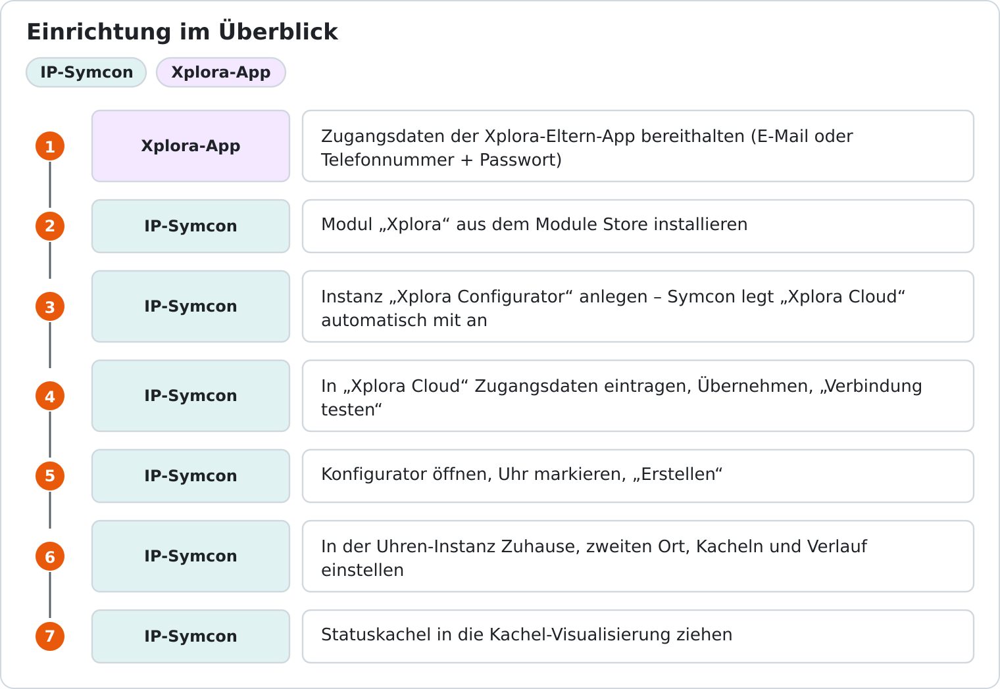
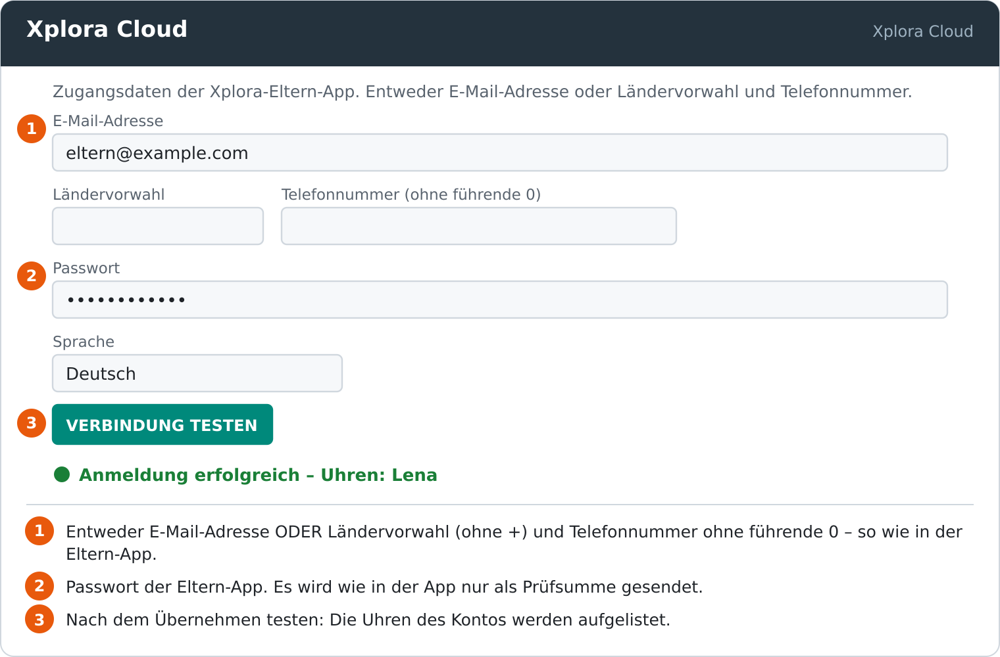
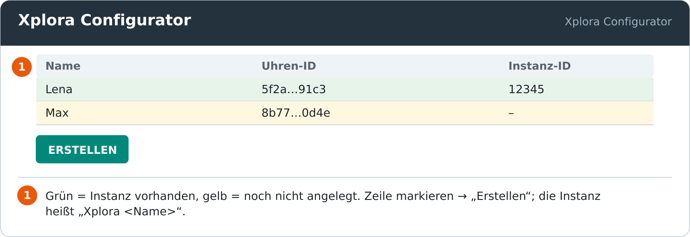
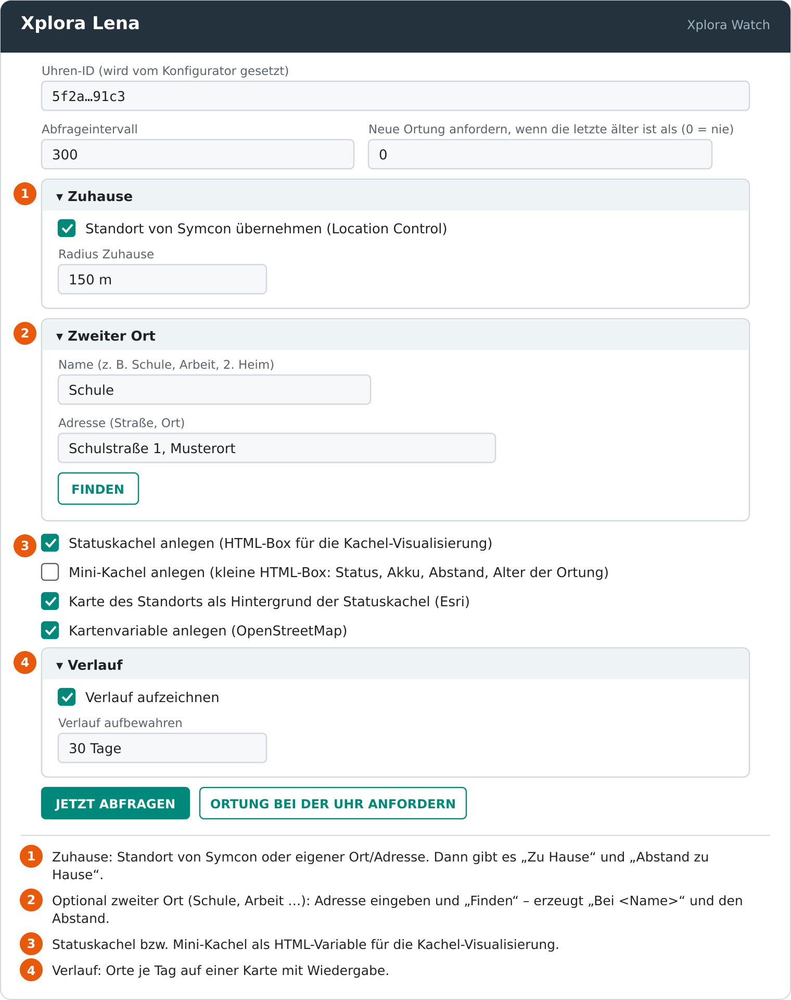
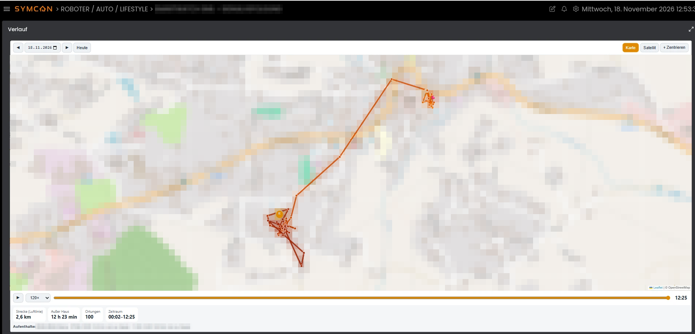
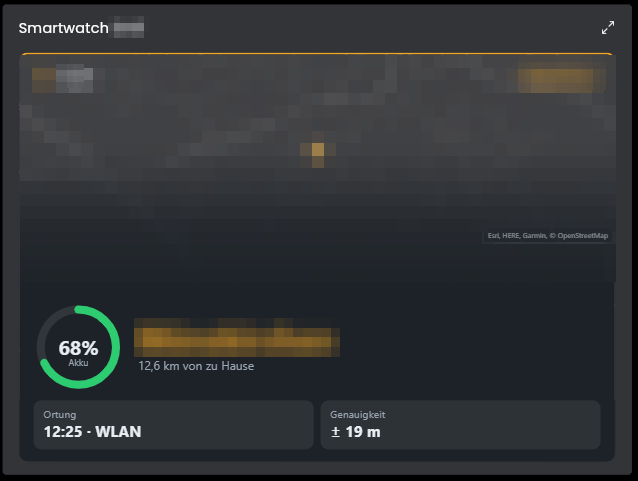
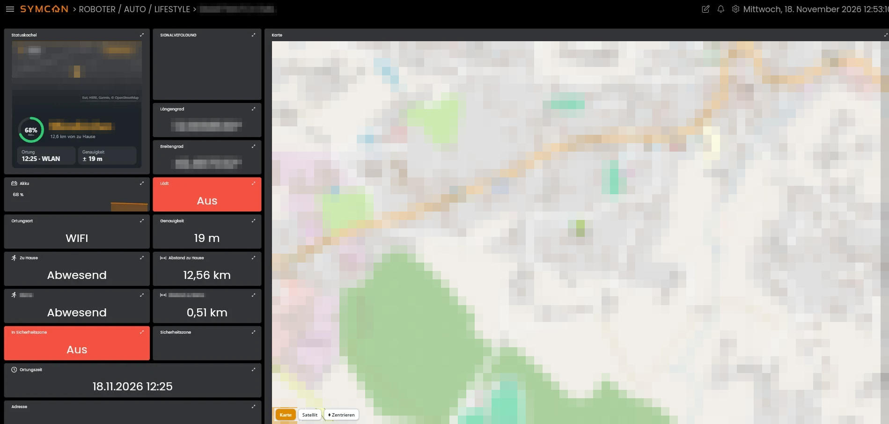

# Xplora

Einbindung von Xplora-Kinder-Smartwatches über die Xplora-Cloud (derselbe Dienst, den die Xplora-Eltern-App nutzt):
Standort, Adresse, Sicherheitszone, Akku und Ladezustand, Abstand und „Zu Hause“ bzw. an einem zweiten Ort,
Statuskachel, Karte und Positionsverlauf.

[English version](README.md)

Die Xplora-Schnittstelle ist nicht offiziell dokumentiert. Die Bibliothek verwendet dieselben Anfragen wie die
Open-Source-Projekte [pyxplora_api](https://github.com/Ludy87/pyxplora_api) und
[ha-xplora-watch](https://github.com/acdcnow/ha-xplora-watch). Xplora kann die Schnittstelle jederzeit ändern.

> Die Bilder sind Schemabilder: Sie zeigen Felder und Reihenfolge, das Aussehen in Symcon weicht etwas ab.
> Namen, IDs und Adressen darin sind Beispiele.

## Module

| Modul | Aufgabe |
| --- | --- |
| [Xplora Cloud](XploraCloud/README.de.md) | Anmeldung am Xplora-Elternkonto, Verbindung zur Cloud (eine Instanz je Konto) |
| [Xplora Configurator](XploraConfigurator/README.de.md) | listet die Uhren des Kontos und legt die Uhren-Instanzen an |
| [Xplora Watch](XploraWatch/README.de.md) | eine Uhr: Standort, Adresse, Sicherheitszone, Akku, Ladezustand, Statuskachel, Karte, Verlauf |

## Voraussetzungen

* IP-Symcon 7.0 oder neuer
* Xplora-Elternkonto (E-Mail-Adresse oder Telefonnummer + Passwort der Eltern-App) mit mindestens einer Uhr
* Internetzugang zu `api.prod.myxplora.com`

## Einrichtung im Überblick

## Einrichtung Schritt für Schritt

### 1. Modul installieren

Verwaltungskonsole → **Module Store** (Korb-Symbol oben rechts) → „Xplora“ suchen → **Installieren**.

Alternativ Kern Instanzen → Modules (Module Control) → **+** → `https://github.com/cbeham1/SymconXplora`.
Nicht beides gleichzeitig – der Store meldet sonst einen Konflikt. Fragt der Store nach der Installation, ob der
Konfigurator angelegt werden soll, kann man das mit **Ja** gleich erledigen (weiter mit Schritt 3).

### 2. Konfigurator anlegen

Objektbaum → **Instanz hinzufügen** → **Xplora Configurator** → **OK**. IP-Symcon legt dabei die Instanz
**Xplora Cloud** unter den I/O-Instanzen mit an.

### 3. Anmeldung in „Xplora Cloud“

1. Die Instanz „Xplora Cloud“ öffnen (I/O Instanzen bzw. im Konfigurator über „Gateway konfigurieren“).
2. **Entweder** die E-Mail-Adresse **oder** Ländervorwahl (ohne „+“, z. B. 43 oder 49) und Telefonnummer ohne führende 0
   eintragen – genau so, wie man sich in der Eltern-App anmeldet.
3. Passwort der Eltern-App und die Sprache für Adressen eintragen → **Übernehmen**.
4. **Verbindung testen**: Es erscheint „Anmeldung erfolgreich“ mit den Namen der Uhren. Der Status wird aktiv.

### 4. Uhren anlegen

Den Konfigurator öffnen. Er listet alle Uhren des Kontos. Uhr markieren → **Erstellen**. Die Instanz heißt
„Xplora `<Name>`“; Kachel und Verlauf zeigen den Namen ohne „Xplora“.

### 5. Uhr einstellen

| Bereich | Empfehlung |
| --- | --- |
| Abfrageintervall | 300 s (Standard). Kürzer = aktueller, aber mehr Anfragen bei Xplora (Drosselung möglich) |
| Neue Ortung anfordern | 0 = nie. Sonst bittet das Modul die Uhr um eine neue Ortung, wenn die letzte älter ist – kostet Akku |
| Zuhause | „Standort von Symcon übernehmen“ (Location Control) oder eigene Adresse → **Finden**; Radius z. B. 150 m |
| Zweiter Ort | Name (z. B. Schule), Adresse → **Finden**, Radius – erzeugt „`<Name>`“ und „Abstand zu `<Name>`“ |
| Statuskachel / Mini-Kachel | HTML-Variablen für die Kachel-Visualisierung; Design „Automatisch“ folgt dem Design der Visualisierung |
| Kartenvariable | Karte mit Umschalter Karte/Satellit und „Zentrieren“ |
| Verlauf | Orte je Tag mit Wiedergabe, Strecke und Aufenthalten (1–60 Tage) |

Nach **Übernehmen** legt die Instanz die Variablen an und liest sofort die erste Ortung.

So sieht die Verlaufsseite aus (Karte und Orte für die Doku verpixelt):

### 6. In die Kachel-Visualisierung

Die Variable **Statuskachel** (bzw. **Mini-Kachel** oder **Karte**) in die Kachel-Visualisierung ziehen und die
Kachelgröße im Bearbeiten-Modus anpassen.

Statuskachel (Ort, Karte und Name für die Doku verpixelt):

Beispiel einer Seite mit Statuskachel, einzelnen Variablen und Kartenvariable (verpixelt):

## Fehlersuche

| Meldung | Ursache und Abhilfe |
| --- | --- |
| Anmeldung abgelehnt | E-Mail bzw. Telefonnummer (ohne führende 0, Vorwahl ohne +) und Passwort wie in der Eltern-App prüfen |
| Von Xplora gedrosselt | zu viele Anfragen; das Modul pausiert eine Stunde. Abfrageintervall verlängern |
| Konfigurator leer | Cloud-Instanz nicht aktiv – Schritt 3 |
| Standort veraltet | Uhr ohne Netz bzw. aus; „Ortung bei der Uhr anfordern“ oder „Neue Ortung anfordern“ einstellen |
| „Zu Hause“ stimmt nicht | Zuhause-Standort bzw. Radius prüfen; bei ungenauer Ortung (WLAN/Funkzelle) Radius vergrößern |

Details je Modul: [Xplora Cloud](XploraCloud/README.de.md), [Xplora Configurator](XploraConfigurator/README.de.md),
[Xplora Watch](XploraWatch/README.de.md).

## Lizenz

MIT, siehe [LICENSE](LICENSE).
