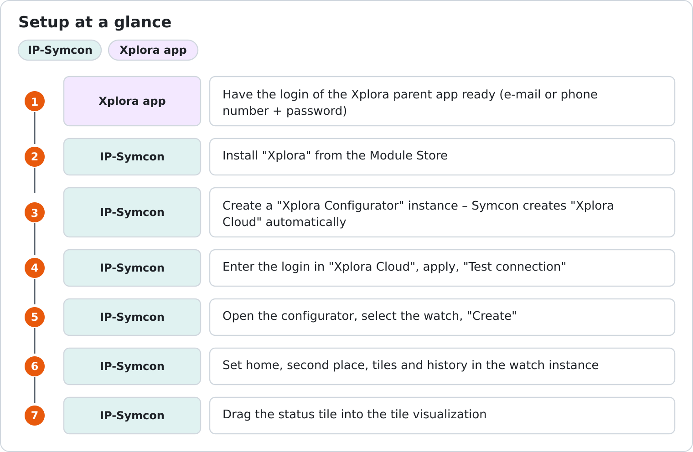
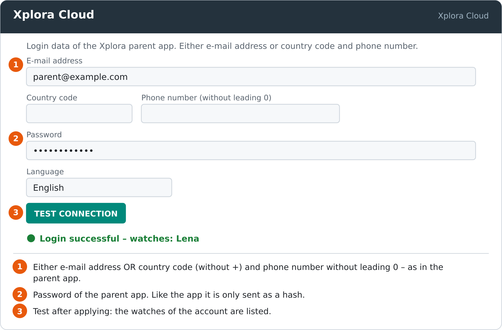
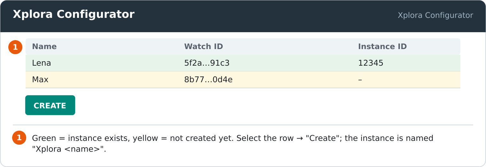
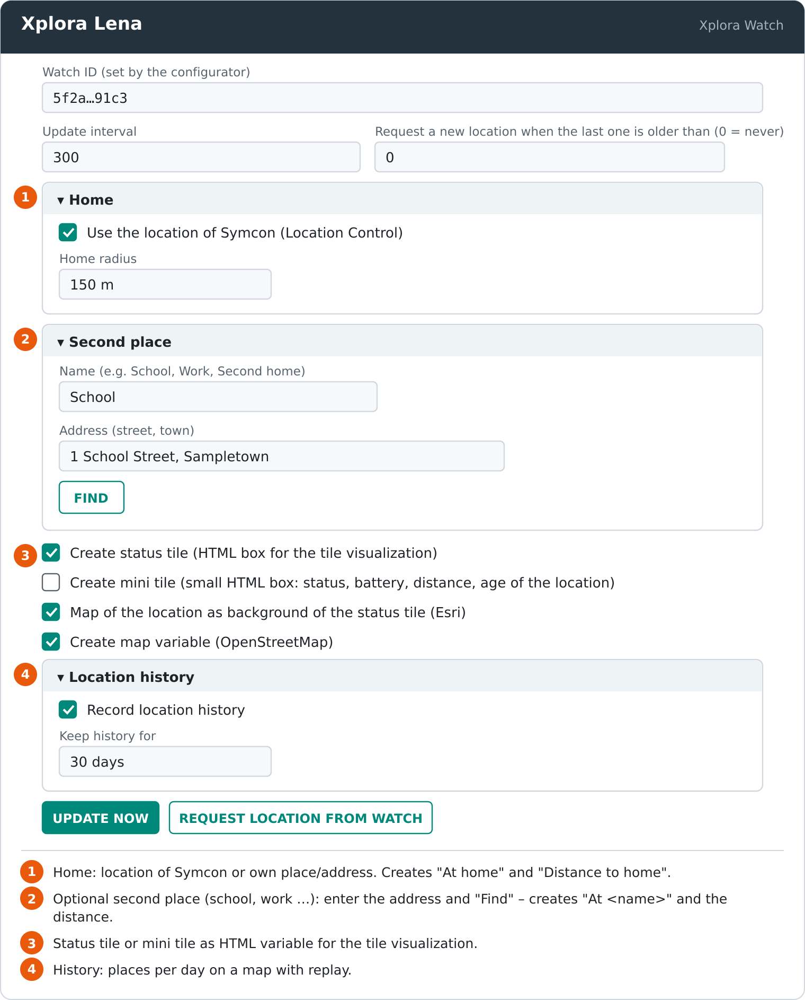
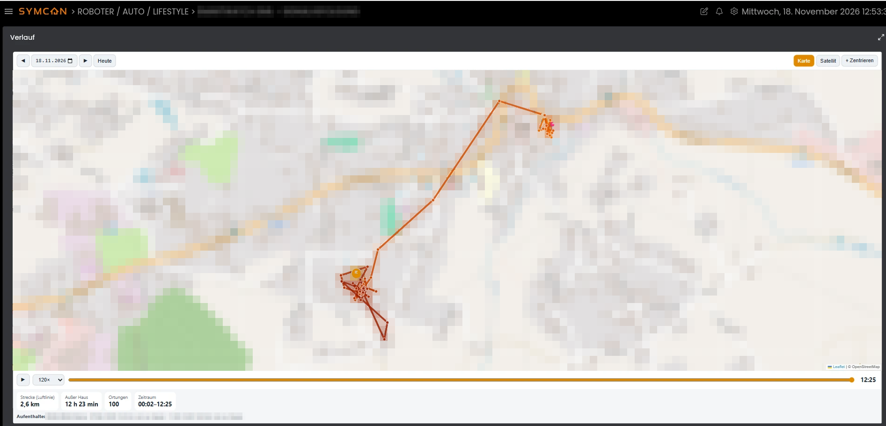
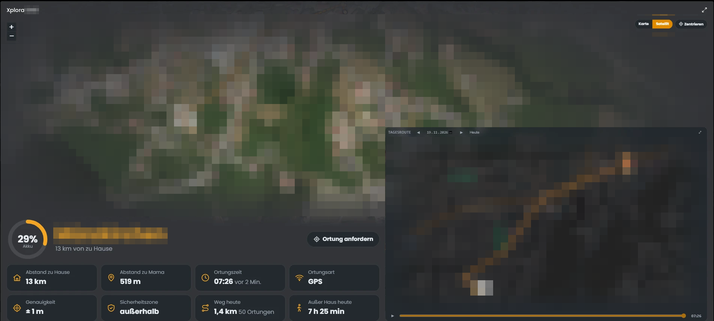
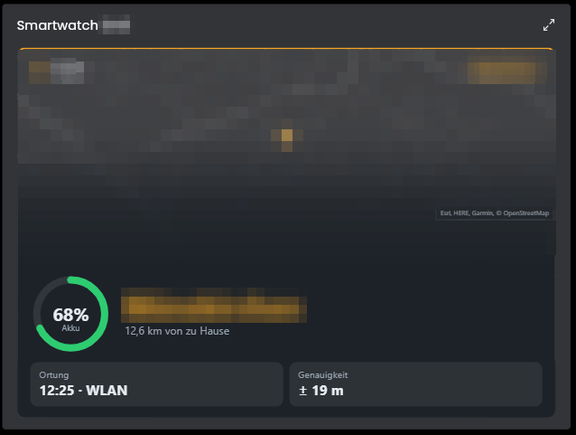
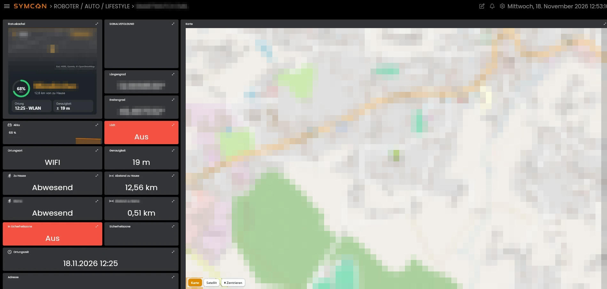

# Xplora

Integration of Xplora kids smartwatches via the Xplora cloud (the same service the Xplora parent app uses):
location, address, safe zone, battery and charging state, distance and "at home" or at a second place,
instance tile for the tile visualization (map, information, day route), status tile, map and location history.

[Deutsche Anleitung](README.de.md)

The Xplora API is not officially documented. This library uses the same requests as the open source projects
[pyxplora_api](https://github.com/Ludy87/pyxplora_api) and [ha-xplora-watch](https://github.com/acdcnow/ha-xplora-watch).
Xplora may change the API at any time.

> The pictures are schematic: they show the fields and their order, Symcon looks slightly different.
> Names, IDs and addresses in them are examples.

## Modules

| Module | Task |
| --- | --- |
| [Xplora Cloud](XploraCloud/README.md) | login to the Xplora parent account, connection to the cloud (one instance per account) |
| [Xplora Configurator](XploraConfigurator/README.md) | lists the watches of the account and creates the watch instances |
| [Xplora Watch](XploraWatch/README.md) | one watch: location, address, safe zone, battery, charging, instance tile, status tile, map, history |

## Requirements

* IP-Symcon 7.0 or newer
* Xplora parent account (e-mail address or phone number + password of the parent app) with at least one watch
* Internet access to `api.prod.myxplora.com`

## Setup at a glance

## Setup step by step

### 1. Install the module

Management console → **Module Store** (basket icon at the top right) → search "Xplora" → **Install**.

Alternatively Core instances → Modules (Module Control) → **+** → `https://github.com/cbeham1/SymconXplora`.
Not both at the same time – the store reports a conflict otherwise. If the store asks after the installation whether
the configurator should be created, answer **Yes** (continue with step 3).

### 2. Create the configurator

Object tree → **Add instance** → **Xplora Configurator** → **OK**. IP-Symcon also creates the **Xplora Cloud**
instance under the I/O instances.

### 3. Log in in "Xplora Cloud"

1. Open the "Xplora Cloud" instance (I/O instances or "Configure gateway" in the configurator).
2. Enter **either** the e-mail address **or** country code (without "+", e.g. 43 or 49) and phone number without the
   leading 0 – exactly as you log in to the parent app.
3. Enter the password of the parent app and the language for addresses → **Apply**.
4. **Test connection**: "Login successful" appears with the names of the watches. The status becomes active.

### 4. Create the watches

Open the configurator. It lists all watches of the account. Select a watch → **Create**. The instance is named
"Xplora `<name>`"; tile and history show the name without "Xplora".

### 5. Configure the watch

| Area | Recommendation |
| --- | --- |
| Update interval | 300 s (default). Shorter = more current, but more requests at Xplora (throttling possible) |
| Request a new location | 0 = never. Otherwise the module asks the watch for a new location when the last one is older – costs battery |
| Home | "Use the location of Symcon" (Location Control) or own address → **Find**; radius e.g. 150 m |
| Second place | name (e.g. School), address → **Find**, radius – creates "`<name>`" and "Distance to `<name>`" |
| Instance as tile | the instance itself as tile (map, information, day route, "Request location") – default on |
| Status tile / mini tile | HTML variables for the tile visualization; design "Automatic" follows the design of the visualization |
| Map variable | map with map/satellite switch and "Center" |
| History | places per day with replay, route and stays (1–60 days) |

After **Apply** the instance creates the variables and reads the first location immediately.

This is what the history page looks like (map and places pixelated for the documentation):

### 6. Into the tile visualization

Drag the **instance "Xplora `<name>`" itself** into the tile visualization (recommended, setting "Instance as tile"):
map over the whole tile (zoom, map/satellite, center, track of today), battery ring, status with "away since" or
"at home since", value boxes (distances, location time, location type, accuracy, safe zone, route and time away today,
address), button **"Request location"** and – with "Record location history" – the **day route** with date selection and replay.
The tile adapts to its size: on big tiles the day route is a panel next to the information, otherwise a picture-in-picture;
⤢ opens the history in the whole tile, "✕ Live" goes back.

Instance tile (maps, place and name pixelated for the documentation):

Alternatively drag the variable **Status tile** (or **Mini tile** or **Map**) into the tile visualization and adjust the tile size
in edit mode.

Status tile (place, map and name pixelated for the documentation):

Example page with status tile, single variables and map variable (pixelated):

## Troubleshooting

| Message | Cause and solution |
| --- | --- |
| Login failed | check e-mail or phone number (without leading 0, country code without +) and password as in the parent app |
| Throttled by Xplora | too many requests; the module pauses for one hour. Increase the update interval |
| Configurator empty | cloud instance not active – step 3 |
| Location outdated | watch without network or switched off; "Request location from watch" or set "Request a new location" |
| "At home" wrong | check home location and radius; increase the radius for inaccurate locations (Wi-Fi/cell) |

Details per module: [Xplora Cloud](XploraCloud/README.md), [Xplora Configurator](XploraConfigurator/README.md),
[Xplora Watch](XploraWatch/README.md).

## License

MIT, see [LICENSE](LICENSE).
