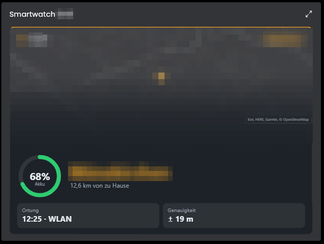
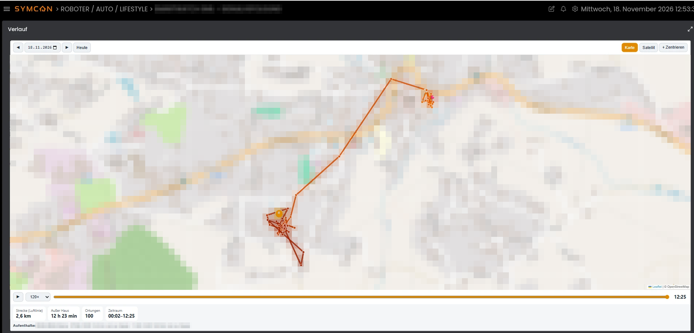

# Xplora Watch

Zeigt Standort, Adresse, Sicherheitszone, Akku und Ladezustand einer Xplora-Uhr – optional mit Statuskachel und Verlauf.

[English version](README.md)

### Inhaltsverzeichnis

1. [Funktionsumfang](#1-funktionsumfang)
2. [Voraussetzungen](#2-voraussetzungen)
3. [Kompatibilität](#3-kompatibilität)
4. [Installation](#4-installation)
5. [Konfiguration](#5-konfiguration)
6. [Statuskachel und Verlauf](#6-statuskachel-und-verlauf)
7. [Statusvariablen und Profile](#7-statusvariablen-und-profile)
8. [PHP-Befehlsreferenz](#8-php-befehlsreferenz)

### 1. Funktionsumfang

* Liest die letzte Ortung der Uhr in einstellbarem Intervall
* Akkustand und Ladezustand
* Adresse, Genauigkeit, Ortungsart (GPS/WLAN/…) und Ortungszeit
* Sicherheitszone der Xplora-App, in der sich die Uhr befindet
* Optional: Abstand zu Zuhause und „Zu Hause“ (Radius plus Genauigkeit der Ortung, max. 200 m Zuschlag)
* Optional: **zweiter Ort** (z. B. Schule, Arbeit, 2. Heim) mit eigenem Namen, Standort und Radius – Variablen
  „`<Name>`“ (anwesend/abwesend) und „Abstand zu `<Name>`“; Statuskachel und Verlauf zeigen den Ort mit an
* Optional: fordert eine neue Ortung an, wenn die letzte zu alt ist (kostet etwas Akku der Uhr)
* Optional: **Statuskachel** für die Kachel-Visualisierung (zu Hause / unterwegs, Abstand, Akku, Ortungszeit),
  mit heller bzw. dunkler Karte des Standorts als Hintergrund (Esri „Gray Canvas“ – Esri, HERE, Garmin, © OpenStreetMap;
  lädt der Browser des Betrachters)
* Optional: Karte als HTML-Box (Leaflet von cdnjs) mit Umschalter Karte (OpenStreetMap-Einbettung) / Satellit (Esri World Imagery, ohne Schlüssel) und „Zentrieren“
* Optional: **Verlauf** (1–60 Tage) – Karte je Tag mit Datumsauswahl, Wiedergabe, farbiger Spur, Strecke,
  Zeit außer Haus und Aufenthalten; in der Instanz gespeichert, Seite über WebHook `/hook/XploraWatch<InstanzID>`
  mit zufälligem Token (Leaflet von cdnjs, OpenStreetMap / Esri World Imagery)

### 2. Voraussetzungen

- IP-Symcon 7.0 oder neuer
- aktive Instanz „Xplora Cloud“

### 3. Kompatibilität

Uhren, die mit der Xplora-Eltern-App genutzt werden können (getestet mit Xplora X6).

### 4. Installation

Am besten über den Xplora Configurator. Manuell: „Instanz hinzufügen“ → „Xplora Watch“ und die Uhren-ID eintragen.

Tipp: Die Instanz „Xplora `<Name>`“ nennen, z. B. „Xplora Lena“ – Kachel und Verlauf zeigen dann „Lena“.

### 5. Konfiguration

| Name | Beschreibung |
| --- | --- |
| Uhren-ID | ID der Uhr in der Xplora-Cloud (setzt der Konfigurator) |
| Abfrageintervall | Sekunden zwischen zwei Abfragen (mindestens 60, Standard 300) |
| Neue Ortung anfordern, wenn … | Minuten, nach denen die Uhr um eine neue Ortung gebeten wird; 0 = nie (Standard) |
| Standort von Symcon übernehmen | nutzt den Standort des Location Control als Zuhause (Standard an) |
| Eigener Standort Zuhause | wenn der Standort von Symcon nicht übernommen wird |
| Adresse + „Finden“ | sucht die Adresse (OpenStreetMap Nominatim) und trägt die Koordinaten (7 Nachkommastellen) in das Standortfeld darüber ein; danach „Änderungen übernehmen“. Gibt es beim zweiten Ort ebenso |
| Radius Zuhause | Meter um Zuhause, die als „zu Hause“ gelten (Standard 150) |
| Zweiter Ort: Name | z. B. Schule, Arbeit, 2. Heim (leer = „Zweiter Ort“) |
| Zweiter Ort: Standort | Standort des zweiten Orts; leer = kein zweiter Ort |
| Zweiter Ort: Radius | Meter um den zweiten Ort (Standard 150, plus Genauigkeit der Ortung, max. 200 m Zuschlag) |
| Statuskachel anlegen | HTML-Box „Statuskachel“ (Standard an) |
| Ort statt „Unterwegs“ anzeigen | zeigt in Status- und Mini-Kachel unterwegs den Ort (Dorf/Stadt) der Ortung statt „Unterwegs“: von Xplora geliefert, sonst über OpenStreetMap Nominatim ermittelt (zwischengespeichert, neue Abfrage erst nach mehr als 300 m) (Standard an) |
| Mini-Kachel anlegen | kleine HTML-Box „Mini-Kachel“ für eine kleine Kachel: Status (farbig), Akku in %, Abstand von zu Hause, Alter der Ortung („15 Min.“, aktualisiert sich im Browser; Abstand ohne Nachkommastellen, z. B. „12 km“) und Akkubalken (Standard aus) |
| Karte als Hintergrund | Karte des Standorts hinter der Statuskachel (Standard an) |
| Design der Statuskachel | Automatisch (Design der Kachel-Visualisierung; Verlauf: Hell/Dunkel des Geräts), Dunkel, Hell – gilt auch für den Verlauf |
| Kartenvariable anlegen | HTML-Box mit OpenStreetMap-Karte der letzten Ortung |
| Verlauf aufzeichnen | speichert die Ortungen und legt die HTML-Box „Verlauf“ an (Standard aus) |
| Verlauf aufbewahren | Tage (1–60, Standard 15) |
| Jetzt abfragen | liest die letzte Ortung sofort |
| Ortung bei der Uhr anfordern | bittet die Uhr, jetzt ihren Standort zu bestimmen |

Xplora begrenzt die Zahl der Anfragen. Kurze Intervalle und häufige Ortungsanforderungen für mehrere Uhren können zur
Drosselung führen (siehe Xplora Cloud).

### 6. Statuskachel und Verlauf

* **Statuskachel:** Variable „Statuskachel“ in die Kachel-Visualisierung ziehen. Grün = zu Hause, orange = unterwegs
  (mit Abstand), violett = am zweiten Ort (zeigt dessen Namen), blau = geortet (ohne Zuhause). Darunter Akkubalken (⚡ beim Laden) und Ortungszeit.
* **Verlauf:** Variable „Verlauf“ in die Visualisierung ziehen (eigene Seite oder große Kachel). Datum wählen,
  „Wiedergabe“ zeigt den Weg des Tages; lange Lücken werden dabei verkürzt. Der zweite Ort ist mit 📍 markiert,
  Aufenthalte dort werden mit seinem Namen aufgeführt.
  Alten Verlauf übernehmen: siehe `XPLW_ImportHistory`.

  

### 7. Statusvariablen und Profile

| Ident | Name | Typ | Profil |
| --- | --- | --- | --- |
| Tile | Statuskachel | String | ~HTMLBox |
| MiniTile | Mini-Kachel | String | ~HTMLBox |
| Battery | Akku | Integer | ~Battery.100 |
| Charging | Lädt | Boolean | |
| AtHome | Zu Hause | Boolean | ~Presence |
| Distance | Abstand zu Hause | Float | XPL.Kilometer |
| AtPlace2 | <Name des zweiten Orts> | Boolean | ~Presence |
| DistancePlace2 | Abstand zu `<Name>` | Float | XPL.Kilometer |
| InSafeZone | In Sicherheitszone | Boolean | |
| SafeZone | Sicherheitszone | String | |
| Address | Adresse | String | |
| Latitude | Breitengrad | Float | XPL.Degree |
| Longitude | Längengrad | Float | XPL.Degree |
| Accuracy | Genauigkeit | Integer | XPL.Meter |
| LocateType | Ortungsart | String | |
| LocateTime | Ortungszeit | Integer | ~UnixTimestamp |
| Map | Karte | String | ~HTMLBox |
| History | Verlauf | String | ~HTMLBox |

„Zu Hause“ und „Abstand zu Hause“ gibt es nur mit Standort Zuhause, die beiden Variablen des zweiten Orts nur mit
dessen Standort (sie werden beim Ändern des Namens umbenannt), „Karte“ und „Verlauf“ nur, wenn aktiviert.

Mit aktiviertem Verlauf registriert das Modul den WebHook `/hook/XploraWatch<InstanzID>` (wird beim Löschen der Instanz
entfernt). Die Seite antwortet nur mit dem zufälligen Token aus der HTML-Box.

Profile des Moduls: `XPL.Kilometer`, `XPL.Degree`, `XPL.Meter`.

### 8. PHP-Befehlsreferenz

`bool XPLW_Update(int $InstanzID);`
Liest die letzte Ortung und aktualisiert die Variablen.

`bool XPLW_RequestLocation(int $InstanzID);`
Bittet die Uhr, ihren Standort zu bestimmen. Die neue Ortung kommt mit einer der nächsten Abfragen.

Beispiel: `XPLW_RequestLocation(12345);`

`int XPLW_ImportHistory(int $InstanzID, string $Punkte);`
Importiert Verlaufspunkte, z. B. aus einem früheren Skript. `$Punkte` ist eine JSON-Liste aus
`[Zeitstempel, Breitengrad, Längengrad, Genauigkeit, Art]` (Genauigkeit und Art optional). Die Punkte werden mit dem
gespeicherten Verlauf zusammengeführt, doppelte Zeitstempel nur einmal übernommen, Punkte älter als die Aufbewahrung
verworfen. Rückgabe: Anzahl gespeicherter Punkte, -1 bei ungültigem JSON.

Beispiel: `XPLW_ImportHistory(12345, '[[1763370000, 48.1, 13.5, 20, "GPS"]]');`
