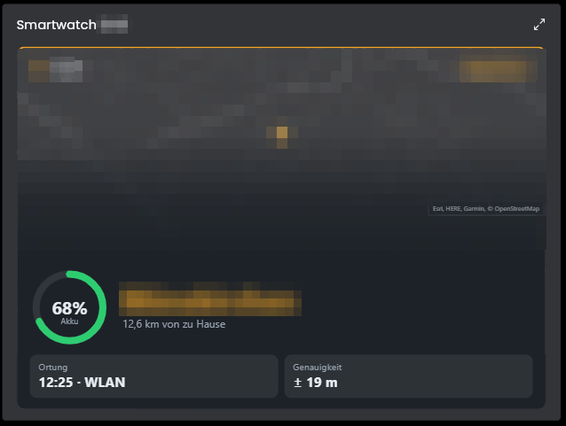
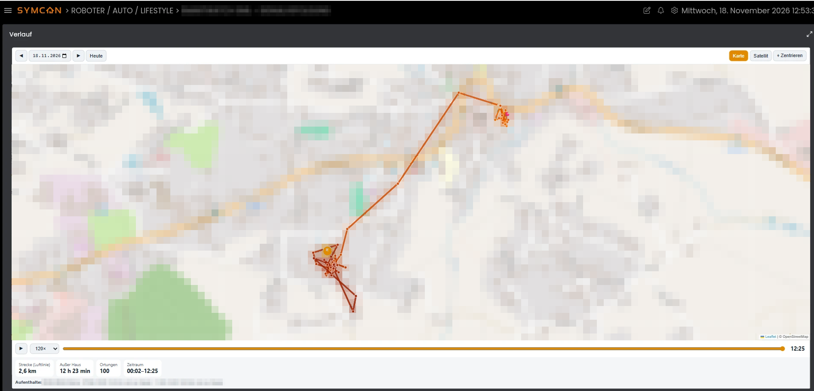

# Xplora Watch

[Deutsche Anleitung](README.de.md)

Shows location, address, safe zone, battery and charging state of one Xplora watch.

### Table of contents

1. [Features](#1-features)
2. [Requirements](#2-requirements)
3. [Compatibility](#3-compatibility)
4. [Installation](#4-installation)
5. [Configuration](#5-configuration)
6. [Status variables and profiles](#6-status-variables-and-profiles)
7. [PHP command reference](#7-php-command-reference)

### 1. Features

* Reads the last location of the watch at a configurable interval
* Battery level and charging state
* Address, accuracy, location type (GPS/WIFI/…) and time of the location
* Safe zone of the Xplora app the watch is in
* Optional: distance to a home location and "At home" (home radius plus accuracy of the location, max. 200 m)
* Optional: second place (e.g. school, work, second home) with its own name, location and radius – variables
  "At `<name>`" and "Distance to `<name>`"; status tile and location history show the place as well
* Optional: asks the watch for a new location if the last one is too old (costs some battery of the watch)
* Optional: status tile for the tile visualization (at home / on the way, distance, battery, time of the location),
  with a light map of the location as background (Esri "Light Gray Canvas" map tiles – Esri, HERE, Garmin, © OpenStreetMap contributors – loaded by the browser of the viewer)
* Optional: map as HTML box (Leaflet from cdnjs) with switch map (OpenStreetMap embed) / satellite (Esri World Imagery, no key needed) and "Center"
* Optional: location history (1–60 days) – map per day with date selection, replay, colored track, distance,
  time away from home and stays; stored in the instance, page delivered by a WebHook `/hook/XploraWatch<InstanceID>`
  protected by a random token (Leaflet from cdnjs, OpenStreetMap / Esri World Imagery)

### 2. Requirements

- IP-Symcon 7.0 or newer
- An active "Xplora Cloud" instance

### 3. Compatibility

Watches that can be used with the Xplora parent app (tested with Xplora X6).

### 4. Installation

Best via the Xplora Configurator. Manually: "Add instance" → "Xplora Watch" and enter the watch ID.

### 5. Configuration

| Name                          | Description                                                                   |
| ----------------------------- | ----------------------------------------------------------------------------- |
| Watch ID                      | ID of the watch in the Xplora cloud (set by the configurator)                 |
| Update interval               | Seconds between two requests (minimum 60, default 300)                         |
| Request a new location …      | Minutes after which the watch is asked for a new location; 0 = never (default) |
| Use the location of Symcon    | Uses the location of the Location Control as home (default on)                |
| Own home location             | Used if the location of Symcon is not used                                     |
| Address + "Find"              | Looks up the address (OpenStreetMap Nominatim) and fills in the coordinates (7 decimals) of the location field above; then apply the changes. Also available for the second place |
| Home radius                   | Meters around the home location that count as home (default 150)             |
| Second place: name            | e.g. School, Work, Second home (empty = "Second place")                        |
| Second place: location        | Location of the second place; empty = no second place                          |
| Second place: radius          | Meters around the second place (default 150, plus accuracy, max. 200 m)        |
| Create status tile            | HTML box "Status tile" for the tile visualization (default on)                 |
| Show the town/village …       | Shows the town/village of the location instead of "On the way" in status and mini tile: delivered by Xplora, otherwise looked up via OpenStreetMap Nominatim (cached, new lookup only after moving more than 300 m) (default on) |
| Create mini tile              | Small HTML box "Mini tile" for a small tile: status (colored), battery, distance from home, age of the location (refreshed in the browser) and battery bar (default off) |
| Map as background             | Shows a map of the location behind the status tile (default on)                |
| Design of the status tile     | Automatic (design of the tile visualization, history: device), dark or light               |
| Create map variable           | HTML box with a map of the last location (map / satellite, "Center")            |
| Record location history       | Stores the locations and creates the HTML box "Location history" (default off) |
| Keep history for              | Days the locations are kept (1–60, default 15)                                 |
| Update now                    | Reads the last location immediately                                           |
| Request location from watch   | Asks the watch to determine its location now                                   |

Xplora limits the number of requests. Short intervals and frequent location requests for several watches can lead to throttling (see Xplora Cloud).

### 6. Status variables and profiles

| Ident      | Name             | Type    | Profile        |
| ---------- | ---------------- | ------- | -------------- |
| Tile       | Status tile      | string  | ~HTMLBox       |
| MiniTile | Mini tile       | string  | ~HTMLBox       |
| Battery    | Battery          | integer | ~Battery.100   |
| Charging   | Charging         | boolean |                |
| AtHome     | At home          | boolean | ~Presence      |
| Distance   | Distance to home | float   | XPL.Kilometer  |
| AtPlace2   | At `<name>`        | boolean | ~Presence      |
| DistancePlace2 | Distance to `<name>` | float | XPL.Kilometer |
| InSafeZone | In safe zone     | boolean |                |
| SafeZone   | Safe zone        | string  |                |
| Address    | Address          | string  |                |
| Latitude   | Latitude         | float   | XPL.Degree     |
| Longitude  | Longitude        | float   | XPL.Degree     |
| Accuracy   | Accuracy         | integer | XPL.Meter      |
| LocateType | Location type    | string  |                |
| LocateTime | Location time    | integer | ~UnixTimestamp |
| Map        | Map              | string  | ~HTMLBox       |

| History    | Location history | string  | ~HTMLBox       |

"At home" and "Distance to home" exist only with a home location, the two variables of the second place only with its
location (they are renamed when the name changes), "Map" and "Location history" only if enabled.

With the location history enabled the module registers the WebHook `/hook/XploraWatch<InstanceID>` at the WebHook Control
(removed again when the instance is deleted). The page only answers with the random token contained in the HTML box.

Profiles created by the module: `XPL.Kilometer`, `XPL.Degree`, `XPL.Meter`.

### 7. PHP command reference

`bool XPLW_Update(int $InstanceID);`
Reads the last location and updates the variables.

`bool XPLW_RequestLocation(int $InstanceID);`
Asks the watch to determine its location. The new location is available with one of the next updates.

Example: `XPLW_RequestLocation(12345);`

`int XPLW_ImportHistory(int $InstanceID, string $Points);`
Imports location history points, e.g. from an earlier script. `$Points` is a JSON list of `[timestamp, latitude, longitude, accuracy, type]` (accuracy and type optional). Points are merged with the stored history, duplicates (same timestamp) are kept once, points older than the configured history days are dropped. Returns the number of stored points, -1 for invalid JSON.

Example: `XPLW_ImportHistory(12345, '[[1763370000, 48.1, 13.5, 20, "GPS"]]');`
